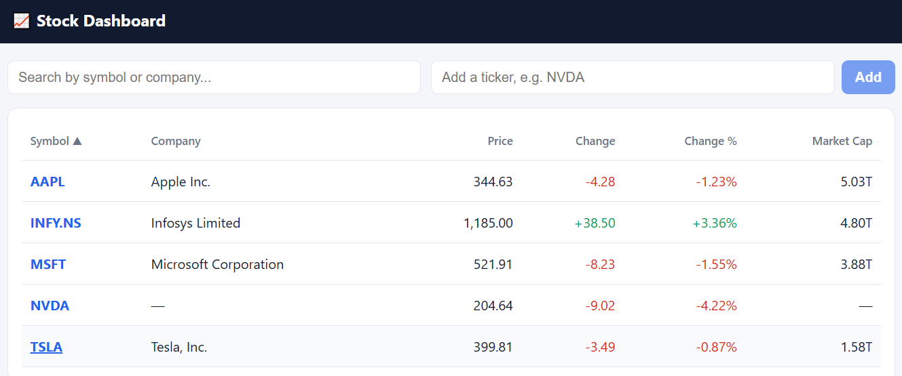
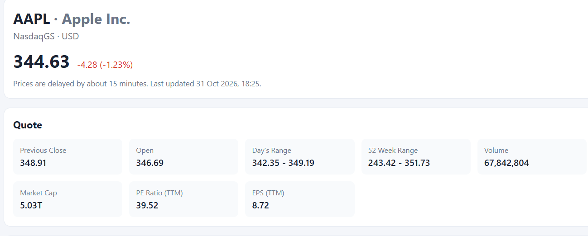
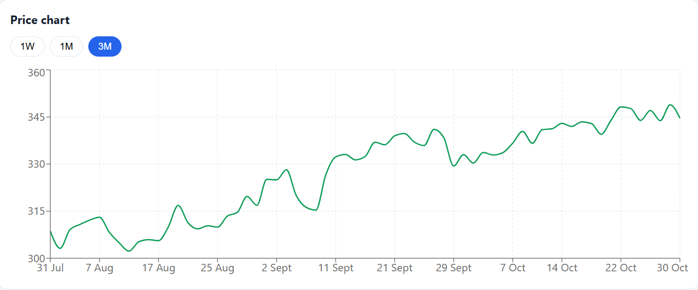

# Yahoo Finance Dashboard

A stock dashboard powered by data from Yahoo Finance. A Python backend collects price details, company information, three months of daily prices and news for any ticker symbol, stores them in SQLite, and serves them through a REST API. A React frontend shows them as a clean dashboard with a price chart.

## Live Demo

| Part | Link |
|---|---|
| Dashboard (frontend, Vercel) | https://yahoo-finance-dashboard-sage.vercel.app |
| API (backend, Render) | https://yahoo-finance-api-83hw.onrender.com |
| Interactive API docs | https://yahoo-finance-api-83hw.onrender.com/docs |

**Cold start:** both are on free tiers. The backend goes to sleep after about 15 minutes without visitors, and the first request afterwards takes up to about 50 seconds while it wakes up. The dashboard shows a loading state, and later requests are fast.

## Technology

| Area | Choice |
|---|---|
| Backend | Python, FastAPI, SQLAlchemy, Alembic (migrations) |
| Database | SQLite |
| Scraping | `yfinance`, an existing Yahoo Finance package |
| Frontend | React (Vite), React Router, Recharts |
| Hosting | Render (backend), Vercel (frontend) |

## Project Structure

```
yahoo-finance-dashboard/
├── backend/
│   ├── app/
│   │   ├── scraper/        # scraping code (kept separate from the API)
│   │   │   ├── yahoo.py    # talks to Yahoo Finance
│   │   │   └── service.py  # saves scraped data to the database
│   │   ├── main.py         # API endpoints
│   │   ├── models.py       # database tables
│   │   ├── schemas.py      # API response shapes
│   │   ├── config.py       # reads environment variables
│   │   └── database.py     # database connection
│   ├── alembic/            # database migrations
│   ├── scrape.py           # the scrape command
│   ├── tickers.json        # seed ticker list
│   ├── requirements.txt
│   └── .env.example
├── frontend/
│   ├── src/                # pages, components, helpers
│   ├── vercel.json
│   └── .env.example
└── docs/screenshots/
```

## Setup Instructions

You need Python 3.12 or newer, Node.js (LTS) and Git.

### 1. Backend

On Windows PowerShell (on Mac or Linux, use `python3` and `source venv/bin/activate`):

```
cd backend
python -m venv venv
venv\Scripts\Activate.ps1
pip install -r requirements.txt
Copy-Item .env.example .env
```

### 2. Database

The database is a single SQLite file (`finance.db`). Create or update its tables with the migrations:

```
alembic upgrade head
```

### 3. Scrape data

```
python scrape.py AAPL          # scrape one ticker
python scrape.py --all         # scrape every ticker in tickers.json
```

### 4. Run the API

```
uvicorn app.main:app --reload
```

The API runs at http://127.0.0.1:8000, and the interactive docs are at http://127.0.0.1:8000/docs.

### 5. Frontend

In a second terminal:

```
cd frontend
npm install
Copy-Item .env.example .env
npm run dev
```

The dashboard opens at http://localhost:5173.

### Environment variables

| Variable | Where | Meaning |
|---|---|---|
| `DATABASE_PATH` | backend | Path of the SQLite file (default `finance.db`) |
| `REQUEST_DELAY_SECONDS` | backend | Pause between requests to Yahoo (default 2) |
| `MAX_RETRIES` | backend | Retry attempts for a failed request (default 3) |
| `REQUEST_TIMEOUT` | backend | Seconds before giving up on a slow response (default 15) |
| `CORS_ORIGINS` | backend | Websites allowed to call the API, comma separated |
| `VITE_API_URL` | frontend | Address of the backend API |

## Data Collection Approach

**Source and tool.** I used the `yfinance` Python package. It reads Yahoo Finance's data directly, which is more reliable than parsing page HTML that changes whenever Yahoo redesigns a page. For each ticker it collects:

- **Summary data:** current price, change, change percent, the quote table (previous close, open, day's range, 52-week range, volume, market cap, P/E, EPS) and the company overview (sector, industry, website, employees, business summary).
- **Historical data:** daily open, high, low, close and volume for the last three months, read as data and not from the paid CSV download.
- **News:** recent headlines with publisher, link and publication time.

**Reliability.**

- **Retries:** each Yahoo call is retried up to `MAX_RETRIES` times, with a growing pause (`REQUEST_DELAY_SECONDS` times the attempt number) between attempts.
- **Delay:** the scraper waits `REQUEST_DELAY_SECONDS` between its calls, and between tickers in a multi-ticker run.
- **Timeout:** the price-history request uses `REQUEST_TIMEOUT`.
- **Headers:** I don't fetch pages directly, so request headers are handled by the `yfinance` package.

**Missing fields.** A missing value is stored as null and the run continues. The names of the missing fields are written to the scrape log and the run is marked **Partial**. The dashboard shows a dash for missing values.

**No duplicates.** Running the same scrape twice updates existing rows instead of adding new ones:

- the ticker symbol is unique
- each ticker has one quote row, which is updated
- historical prices have a unique constraint on (ticker, date)
- news articles have a unique URL

**Invalid or delisted tickers.** If Yahoo has no data for a symbol, nothing is saved, the failure is logged in `ScrapeLog`, and the API answers with a clear message ("We couldn't find a ticker called ..."), not an error trace.

**Scrape log.** Every run writes a `ScrapeLog` row with status (Success, Partial or Failed), start and finish times, records affected and an error message.

**Note:** prices on Yahoo Finance are delayed by about 15 minutes.

## API Documentation

Base URL: `https://yahoo-finance-api-83hw.onrender.com`. Every list endpoint is paginated with `page` and `page_size`. Example responses below are shortened.

| Method | Endpoint | Description |
|---|---|---|
| GET | `/api/tickers` | List tracked tickers with their latest quote. Query: `search`, `sort_by`, `order`, `page`, `page_size` |
| POST | `/api/tickers` | Add a ticker by symbol, which triggers a scrape. Body: `{"symbol": "NVDA"}` |
| GET | `/api/tickers/{symbol}` | Full detail for one ticker (company information and latest quote) |
| GET | `/api/tickers/{symbol}/history` | Historical prices. Query: `start`, `end` (YYYY-MM-DD), `page`, `page_size` |
| GET | `/api/tickers/{symbol}/news` | News articles for a ticker |
| GET | `/api/scrape-logs` | Recent scrape logs, newest first |
| GET | `/api/health` | Health check |

Errors return a short message: `400` for a badly formed symbol, `404` for an unknown ticker, `502` when Yahoo Finance can't be reached, and `500` for anything unexpected, in the form `{"detail": "..."}`.

### GET /api/tickers

```json
{
  "count": 4,
  "page": 1,
  "page_size": 20,
  "total_pages": 1,
  "results": [
    {
      "id": 1,
      "symbol": "AAPL",
      "company_name": "Apple Inc.",
      "exchange": "NasdaqGS",
      "currency": "USD",
      "last_scraped_at": "2026-10-31T12:55:10.689955",
      "quote": {
        "current_price": 344.63,
        "change": -4.28,
        "change_percent": -1.2267,
        "previous_close": 348.91,
        "open_price": 346.685,
        "days_low": 342.35,
        "days_high": 349.19,
        "week52_low": 243.42,
        "week52_high": 351.73,
        "volume": 67842804,
        "market_cap": 5029592301568,
        "pe_ratio": 39.52179,
        "eps": 8.72,
        "scraped_at": "2026-10-31T12:55:10.697166"
      }
    }
  ]
}
```

### POST /api/tickers

Request body: `{"symbol": "NVDA"}`. Returns `201` with the full ticker detail. Unknown symbol:

```json
{ "detail": "We couldn't find a ticker called 'XYZ123'. Please check the symbol and try again." }
```

### GET /api/tickers/AAPL/history

```json
{
  "count": 63,
  "page": 1,
  "page_size": 100,
  "total_pages": 1,
  "results": [
    {
      "date": "2026-10-30",
      "open_price": 346.685,
      "high_price": 349.19,
      "low_price": 342.35,
      "close_price": 344.63,
      "volume": 67842804
    }
  ]
}
```

### GET /api/tickers/AAPL/news

```json
{
  "count": 10,
  "page": 1,
  "page_size": 20,
  "total_pages": 1,
  "results": [
    {
      "id": 1,
      "title": "Example headline",
      "url": "https://example.com/article",
      "source": "Example Publisher",
      "published_at": "2026-10-30T14:30:00"
    }
  ]
}
```

### GET /api/scrape-logs

```json
{
  "count": 1,
  "page": 1,
  "page_size": 20,
  "total_pages": 1,
  "results": [
    {
      "id": 5,
      "ticker_symbol": "NVDA",
      "status": "Partial",
      "started_at": "2026-11-01T00:13:10",
      "finished_at": "2026-11-01T00:13:40",
      "records_affected": 66,
      "error_message": "Missing fields: company_name, market_cap"
    }
  ]
}
```

## Screenshots

**Ticker list**



**Ticker detail**



**Price chart and news**



## Deployment

- **Backend** runs on Render's free plan (Python 3.12, root directory `backend`, start command `uvicorn app.main:app --host 0.0.0.0 --port $PORT`).
- **Frontend** runs on Vercel's free plan (root directory `frontend`, with `VITE_API_URL` pointing to the Render API). `vercel.json` sends every route to `index.html` so refreshing a ticker page works.
- **Seed data:** I scraped AAPL, MSFT, TSLA and INFY.NS locally and committed the resulting `finance.db`, so the deployed dashboard is never empty. Scraping from Render also works, since adding NVDA from the live dashboard succeeded, but the company details for it came back incomplete and the run was logged as Partial.

## Known Limitations

- **Data added on the live site may not last.** Render's free plan has temporary disk storage, so a restart or redeploy resets the database to the committed `finance.db`. Tickers added from the live dashboard (like NVDA) can disappear, while the four seeded ones always come back. A hosted database such as PostgreSQL would fix this.
- **Cold starts.** The free backend sleeps when idle, and the first request can take up to about 50 seconds.
- **Unofficial data source.** `yfinance` is not an official Yahoo API. Yahoo can rate-limit cloud servers or change its data, which can produce Partial results with missing fields.
- **Slow "add ticker".** The request waits for the scrape to finish (up to about 30 seconds). With more time I would run scrapes as a background job and let the page check for completion.
- **Timeout coverage.** The timeout setting applies to the price-history request. The summary and news calls rely on the package's defaults.
- **Latest quote only.** The `Quote` table keeps one latest snapshot per ticker, not a history of snapshots. Price history comes from the `HistoricalPrice` table.
- **No scheduled scraping.** Data updates only when you run the scrape command or add a ticker. A scheduled job would keep it fresh.
- **No automated tests or login.** I tested by hand, and the API is open and has no user accounts.